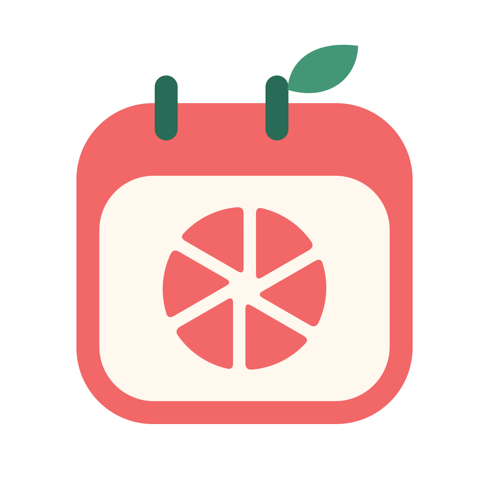

<div align="center">



# 红柚 MELO

**让每一节课，都安排得刚刚好。**

面向独立教师和小型工作室的开源约课与课时管理系统。

<p>
  
  
  
  
</p>

**轻量 · 开源 · 易部署**

</div>

---

## 📖 项目简介

**红柚 MELO** 是一款面向独立教师和小型工作室的开源排课约课系统。

帮助老师轻松管理课程、预约、学员及课时，让教学安排更加简单高效。

## ✨ 核心功能

> 以下为规划功能，具体完成情况以项目发布版本为准。

- 📅 **课程排期**：老师发布可预约时间段
- 📱 **在线约课**：学生通过微信小程序预约课程
- 👥 **学员管理**：管理学员信息和课程资料
- ⏰ **课时管理**：记录已上课时及剩余课时
- 📊 **课程记录**：查询预约记录与历史课表
- 🖥️ **管理后台**：支持 Web 端课程与学员管理

## 🛠️ 技术栈

| 模块 | 技术 |
|------|------|
| 后端 | Go + Gin |
| 数据库 | MySQL |
| 微信小程序 | 微信小程序原生框架 |
| Web 管理端 | Vue 3 |
| 部署 | Docker Compose |

## 📂 项目结构

```text
melo/
├── server/         # Go 后端
├── miniprogram/    # 微信小程序
├── admin-web/      # Web 管理端
├── deploy/         # 部署配置
└── docs/           # 项目文档
```

## 🚀 快速开始

项目正在开发中，部署指南将随首个可运行版本发布。

## 🤝 参与贡献

欢迎提交 Issue、功能建议及 Pull Request。

## 📄 开源许可

许可证将在正式开源发布前确定。
